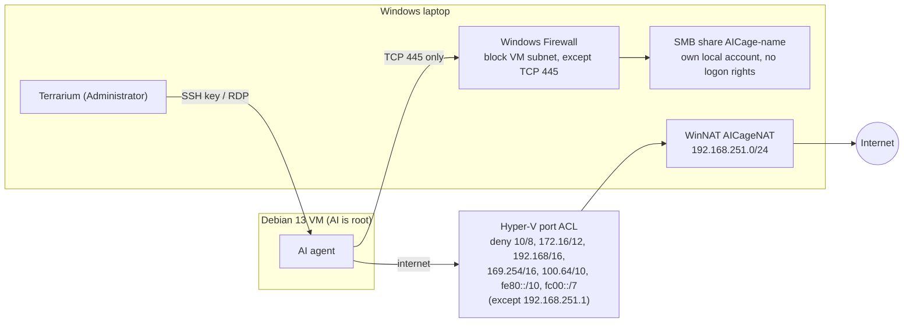

# Terrarium security

This document explains what Terrarium protects, how, and where the protection ends. It is
written for people who run AI agents (Claude Code, Codex and the like) in a Terrarium VM, and for
anyone reviewing the tool.

Short version: **the VM is a strong wall, the shared folder is a door.** Terrarium keeps the AI
away from your files, your network and your other VMs. What passes through the door - files the
AI writes, and anything you open from the VM on Windows - is your responsibility.

- [Threat model](#threat-model)
- [How the cage is built](#how-the-cage-is-built)
- [Risk overview](#risk-overview)
- [Options that add risk](#options-that-add-risk)
- [Risks that are always there](#risks-that-are-always-there)
- [Checklist](#checklist)
- [Ideas for later versions](#ideas-for-later-versions)
- [Reporting a vulnerability](#reporting-a-vulnerability)

## Threat model

Terrarium assumes the worst about what runs **inside** the VM:

- The AI is **root** in its VM (passwordless `sudo` is the default, and the password is known).
- It may be wrong, careless, or steered by someone else: a web page, a README, an issue or a
  package can carry instructions (*prompt injection*), and an installed package can be malware.
- It has the **internet**. It can download anything and upload anything it can read.

What Terrarium protects **from** the VM:

| Asset | Protected? |
|---|---|
| Your files outside the shared folder | Yes - the VM has no path to them |
| Services on the laptop (RPC, NetBIOS, Remote Desktop, WinRM, anything listening) | Yes - firewall; only the shared folder's port 445 is open, and not even that without a shared folder |
| Your home / office / cowork network (router, NAS, printers, other PCs) | Yes in *Strict* mode, **no** in *Open* mode |
| Company networks behind a split-tunnel VPN | Yes in *Strict* mode, once Terrarium has seen the VPN's routes |
| The laptop's name, domain and Windows build | Yes - not passed to the VM |
| Other VMs (Terrarium or not) | Yes - Hyper-V filter on the VM's network port |
| Your GitHub / cloud logins on Windows | Yes - they never enter the VM |
| The shared folder (if you share one) | **No** - the AI can read it, and change it unless it is read-only |
| Secrets you put into the VM (API keys, tokens, `claude` / `codex` logins) | **No** - the AI can read and send them |
| What you do on Windows with files from the VM | **No** - see [shared folder](#writable-shared-folder) |

Out of scope: attacks on Windows itself from outside, a Windows account that is already
compromised, and people with physical access to the laptop.

**Trust Terrarium itself only after reading it.** It runs as Administrator. It is two plain
text files - `Terrarium.cmd` and `Terrarium.ps1` - so check where your copy came from and what
it does before the first run and after every update. The README's *Check it yourself* lists what
to look at.

## How the cage is built



Layer by layer:

1. **Hyper-V VM.** A separate kernel and memory. The VM runs Debian's official cloud image,
   downloaded from `cloud.debian.org` and checked against Debian's SHA512 list.
2. **Own virtual switch and NAT.** VMs sit on an internal switch (`AICage`, `192.168.251.0/24`)
   with NAT to the internet. IPv6 is switched off on the laptop's side of that switch.
3. **Network filter outside the VM.** In *Strict* mode, Hyper-V port ACLs on the VM's network
   adapter deny every private, link-local and carrier-grade-NAT range, IPv4 and IPv6, except the
   laptop's address on the VM switch - and every public-address network the laptop has its own
   route to (split-tunnel VPNs, an office LAN on public addresses), plus `BlockRanges` from
   `config.json`. The rules live on the host: root in the VM cannot change them. They follow the
   laptop's routes at start, *Check again*, *Start* and *Test and secure*. DHCP guard and router
   guard are on, so a VM cannot pose as a router or DHCP server.
4. **Windows Firewall.** Two block rules (block always wins over allow) close every TCP port
   except 445, and all UDP, to the VM subnet. A per-VM allow rule opens TCP 445 from that VM's
   address to the laptop's VM-switch address only.
5. **One share per VM, one account per share - or none.** Without a shared folder, a VM gets no
   share and no account, and a block rule for TCP 445 from its address - so not even Windows' own
   *File and Printer Sharing* rules can open the port to it. With one, each VM
   gets its own local Windows account
   (`aic-<name>`) with a random 24-character password. It is removed from *Users* and denied
   interactive, Remote Desktop, batch and service logon. The SMB share allows only that account,
   and only on the chosen folder (read-only if you tick it). Terrarium refuses whole drives,
   Windows, Program Files, ProgramData, `C:\Users` and your profile folder itself, and warns
   about risky folders (see [What you share](#what-you-share)).
6. **Logins.** The Terminal button uses a per-VM ed25519 key whose file only you, Administrators
   and SYSTEM can read. The first host key is pinned (`StrictHostKeyChecking=accept-new`). SSH
   agent and X11 forwarding are not used.
7. **Remote Desktop shares nothing.** The `.rdp` file turns off drives, printers, COM ports,
   smart cards, cameras, other devices and the microphone. Sound and the clipboard are off unless
   you tick them for that VM.
8. **The VM is not told who the laptop is.** Hyper-V's *Data Exchange* service, which would
   give the VM the laptop's name, domain and Windows build, is off; older VMs are switched over
   (and the details they got deleted) at the next check.
9. **Secrets are cleaned up.** The cloud-init seed ISO (it holds the passwords) is detached and
   deleted after the first boot; cloud-init's copies of it inside the VM are deleted and
   cloud-init is switched off.
10. **Checked, repaired, quarantined.** After creation, and whenever you click *Test and secure*,
   the VM tries to reach the laptop's ports, the router, the laptop's LAN address, the other VMs
   and the laptop's `C$` share. If anything is reachable that must not be, Terrarium re-applies
   the protection and tests again; if it is still open, it **disconnects the VM's network**
   (quarantine) until a later test passes.
11. **Terrarium's own files.** The folders with keys, VM disks, the base image and the per-VM
    shared folders are limited to Administrators, SYSTEM and you.

## Risk overview

Levels: **High** - realistic way to harm the laptop or your data, take it seriously.
**Medium** - needs a specific situation or a mistake. **Low** - small or theoretical gain for
an attacker. **Info** - worth knowing, no action needed.

| # | What | Default | Level | In one line |
|---|---|---|---|---|
| 1 | [Writable shared folder](#writable-shared-folder) | on | **High** | Files the AI writes can run on Windows when you open or use them |
| 2 | [What you choose to share](#what-you-share) | your choice | **High** | Anything in the folder can be read and uploaded; Terrarium warns about risky folders |
| 3 | [Secrets inside the VM](#secrets-inside-the-vm) | - | **High** | API keys and logins in the VM belong to the AI too |
| 4 | [Open network](#open-network) | off | **High** | The AI reaches your LAN: router, NAS, printers, other PCs |
| 5 | [Ports to this laptop](#ports-to-this-laptop) | none | **Medium** | `localhost` pages from the VM share cookies with your local apps |
| 6 | [Copy and paste](#copy-and-paste) | off | **Medium** | *with clipboard*, or terminal escape codes, cross the wall |
| 7 | [Windows' SMB server is reachable](#smb-server) | with a shared folder | **Medium** | Root in the VM can talk to the laptop's file-sharing service |
| 8 | [Full-tunnel VPNs and public services](#full-tunnel-vpns-and-public-services) | always | **Medium** | What the laptop reaches through the internet, the VM reaches too |
| 9 | [Desktop (Remote Desktop)](#desktop) | off | **Low** | The VM talks to Windows' Remote Desktop program and can draw fake dialogs |
| 10 | [Desktop sound](#desktop-sound) | off | **Low** | One more data stream into Remote Desktop's audio code |
| 11 | [Password and SSH](#password-and-ssh) | `ai` / `ai` | **Low** | Any program on the laptop can log in to the VM |
| 12 | [Laptop details](#laptop-details) | hidden | **Info** | Laptop name, domain and Windows build are no longer passed to the VM |
| 13 | [Hyper-V escape](#hyper-v-escape) | always | **Low** | A hypervisor bug would break the wall |
| 14 | [Downloads during setup](#downloads-during-setup) | always | **Low** | Image and tools are trusted over HTTPS |
| 15 | [Firewall depends on Windows](#firewall-depends-on-windows) | always | **Low** | A company policy can switch local firewall rules off |
| 16 | [Start with Windows](#start-with-windows) | on | **Info** | An agent keeps working while you are not looking |
| 17 | [Test and secure trusts the VM](#test-and-secure-trusts-the-vm) | - | **Info** | It finds mistakes, not a VM that lies |

The **Risks** column in Terrarium's window lists, per VM, the options from this table it has on
(open network, localhost ports, sound, clipboard, writable share). The New VM and Settings
dialogs show the risk of an option next to it, in amber; choosing *Open* network, or a shared
folder with red flags, asks for confirmation.

## Options that add risk

### Writable shared folder

**High.** The shared folder is the one place where the AI's work reaches Windows. Reading it is
harmless; *using* what is in it is not. Everything below runs code that the AI controls, on
Windows, as you:

- double-clicking a script or program (`.bat`, `.cmd`, `.ps1`, `.vbs`, `.js`, `.exe`, `.msi`,
  `.lnk`, `.hta`, Office files with macros). Files in a local folder get **no** "downloaded from
  the internet" mark, so Windows does not warn you.
- **git** on Windows (git, Sourcetree, GitHub Desktop, VS Code's git): hooks in `.git/hooks/` and
  settings in `.git/config` such as `core.fsmonitor`, `core.hooksPath`, `core.sshCommand`,
  `core.pager`, `diff.external` or a `filter` driver. See the README's *Git repositories in a
  shared folder*.
- **editors and IDEs**: VS Code `.vscode/tasks.json` (tasks can run on folder open),
  `.vscode/settings.json` (paths to tools such as the Python interpreter or linters),
  recommended extensions, JetBrains run configurations. VS Code's *Workspace Trust* asks once -
  answer **No** (Restricted Mode) for shared folders.
- **build and package tools** on Windows: `npm install` (lifecycle scripts), `pip install .`,
  `make`, `gradle`, `dotnet build` (MSBuild targets), `pre-commit`, `direnv`, `.env` files read
  by your tools.
- **Explorer itself**: shortcut and icon files (`.url`, `.lnk`, `.library-ms`,
  `.searchConnector-ms`, `desktop.ini`) can point Explorer at a network path. The VM is
  reachable from the laptop, so the AI can run an SMB server there and make Explorer connect to
  it - Windows then sends a hash of your Windows login, which can be cracked offline if the
  password is weak. Previews and thumbnails also parse files the AI wrote.

What helps:

- Untick **Share a folder of this laptop with the VM** when the AI does not need your files at
  all. Work then moves through `git` (with a token limited to that repository) or `scp`. Settings
  can add a folder later.
- Tick **The VM may only read this folder** when the AI only needs to read (reviews, analysis).
- Treat files from the shared folder like **downloads from the internet**. Read diffs before you
  commit or run anything; push from a separate clone outside the shared folder.
- Open the folder in your IDE in restricted / untrusted mode.
- Stop Windows from ever opening an SMB connection *to* the VMs (Terrarium never needs one; the
  VM mounting your share is the other direction and keeps working):

  ```powershell
  New-NetFirewallRule -Name 'AICage-NoSmbToVMs' -DisplayName 'Terrarium - laptop never opens SMB on VMs' `
      -Group 'Terrarium' -Direction Outbound -Action Block -Protocol TCP -RemotePort 139,445 `
      -RemoteAddress 192.168.251.0/24 -Profile Any
  ```

### What you share

**High.** The AI can read everything in the shared folder and upload it anywhere. Terrarium
refuses only the obvious mistakes (a whole drive, Windows, Program Files, ProgramData,
`C:\Users`, your profile folder). For everything else it **warns** - in red under the folder,
once more in a question when you click *Create VM* or *Apply*, and in the log - when the folder:

- **contains Terrarium itself** (or a copy of `Terrarium.ps1`) - the AI could change it, and
  your next start runs it as Administrator. Keep Terrarium outside every shared folder;
- contains Terrarium's data folder `.aicage` (keys, VM disks);
- is synced to the cloud (OneDrive, Dropbox, Google Drive, iCloud, Box) - changes and deletions
  reach every synced device;
- is, or contains, your whole Documents, Desktop, Downloads, Pictures or AppData folder;
- holds, up to three levels down, what usually contains secrets: `.ssh`, `.aws`, `.azure`,
  `.kube`, `.gnupg`, `.docker`, `.git-credentials`, `.npmrc`, `.pypirc`, `.netrc`, `.env*`,
  `id_rsa` / `id_ed25519`, `*.kdbx`, `*.pfx`, `*.p12`, `*.pem`, `*.key`, `*.ovpn`.

The decision stays yours. Best: a dedicated project folder; several VMs can have several folders.

### Secrets inside the VM

**High** - by design, but often forgotten. Whatever you type or copy into the VM is the AI's:
the `claude` / `codex` login, API keys, GitHub tokens, cloud credentials, SSH keys, `.npmrc`.
A prompt-injected agent can send them anywhere.

- Use **separate, limited** keys for the VM: a project-scoped token, a fine-grained GitHub token
  for one repository, an API key with a spending limit. Revoke them when the work is done.
- Do not forward your SSH agent or copy your personal SSH key into the VM.
- The VM also holds the password of its share account (`/root/.smb-aicage`). That account can
  open only this VM's share and cannot log on to Windows, so this is expected.

### Open network

**High.** *Open* removes the Hyper-V filter: the VM may reach everything the laptop can reach on
its local networks - the router's admin page, NAS, printers, cameras, smart-home devices, other
computers, and at work the company network. A compromised agent can scan, log in with default
passwords, or attack old devices. The laptop's own services stay closed (the firewall rules do
not depend on this setting).

Use *Open* only when the VM really needs a local device, preferably on a network with nothing to
protect, and switch back to *Strict* afterwards. Terrarium asks for confirmation before switching
to *Open*.

### Ports to this laptop

**Medium.** A forward makes a port in the VM appear as `localhost:<port>` on the laptop. Only the
laptop sees it, not your network. But browsers treat `localhost` as **one site, whatever the
port**:

- cookies of `localhost:3000` (your own app, Jupyter, a local admin page) are also sent to
  `localhost:8080`, which is now served by the VM;
- a page from the VM on `localhost` counts as *same-site* for your other local apps, so
  `SameSite` cookie protection against forged requests does not apply between them;
- every program and user on the laptop can connect to the forwarded port.

What helps: to just *look at* something the VM serves, open `http://<VM address>:<port>` (e.g.
`http://192.168.251.10:8080`) - a separate site, no forward needed. Forward only what a Windows
program really needs to reach as `localhost`, and remove forwards when done. Never forward port
22 or 3389.

### Copy and paste

**Medium**, when you turn it on.

- **Remote Desktop clipboard** is off. *with clipboard* (New VM / Settings, next to *with
  sound*) turns it on for that VM - in **both** directions: while a desktop window is open, the
  VM can read whatever you copy on Windows (often passwords) and put text into your clipboard.
  Turn it on for a task and off afterwards.
- **Terminal escape codes.** Text printed in the terminal is interpreted by the terminal
  program on Windows. Windows Terminal supports *OSC 52*, which lets the program on the other
  side **write to your clipboard**, and shows clickable links that may not lead where their text
  says. Never paste something you did not copy yourself into PowerShell or Run, and be careful
  with links in VM output.
- The Hyper-V **Screen** window (*vmconnect*) uses the basic session: no clipboard, no drives. If
  you ever set up Hyper-V's *enhanced session* for a VM, that shares the clipboard and can share
  drives - Terrarium does not set it up.

### Desktop

**Low.** The Desktop button opens the VM's desktop in Windows' Remote Desktop client (`mstsc`).
It shares nothing of the laptop. Two things remain:

- `mstsc` processes everything the VM sends: graphics, window size changes, sound when on.
  Security bugs in Remote Desktop **clients** have been found and fixed in the past; keep Windows
  updated.
- The VM can draw anything in that window - including a perfect copy of a Windows sign-in or
  UAC dialog. **Never type your Windows password into the Remote Desktop window.** The only
  password it should ever ask for is the VM's Linux password.

### Desktop sound

**Low.** *with sound* plays the VM's sound on the laptop. It only goes from the VM to Windows;
the microphone is never shared. It adds the Remote Desktop audio channel: the VM chooses the
audio format and sends a data stream that `mstsc` and Windows' audio stack decode. That is one
more piece of Windows code the AI can feed data to. No practical attack is known, so the risk is
low - but it is not zero, so the option is off by default. Turn it on for watching videos or
testing audio, off when you do not need it. It takes effect at the next Remote Desktop
connection.

### Password and SSH

**Low.** The default Linux login is `ai` / `ai`, and SSH accepts passwords. The VM is reachable
only from the laptop, so this mainly matters when **other people or untrusted programs** use the
same Windows machine: any of them can log in to the VM. Choose a real password then. The
Terminal button does not need the password (it uses the per-VM key). Passwordless `sudo` is the
point of the cage: the AI may administer its VM.

### Start with Windows

**Info.** On by default. The VM starts with Windows, and an agent left running (e.g. in `tmux`)
keeps working with internet access while you are not watching. Turn it off for VMs you use only
now and then, and stop VMs you do not use.

## Risks that are always there

### SMB server

**Medium** (large impact, low likelihood). The shared folder needs TCP 445, so root in the VM can
talk to Windows' file-sharing server, which runs in the Windows kernel. Bugs there have allowed
remote code execution before (e.g. *SMBGhost*, 2020). The VM also logs in with its share account,
which lets it ask Windows a few things over SMB that do not need administrator rights, such as
the names of other shares (including the other VMs' `AICage-*` shares) and, depending on
Windows' settings, the names of local accounts.

What helps: a VM without a shared folder cannot reach port 445 at all; keep Windows updated;
remove VMs you no longer use; remember that the share account has no rights outside its folder.

### Full-tunnel VPNs and public services

**Medium** for laptops that join company networks. *Strict* blocks private, link-local and
carrier-grade-NAT ranges, every public-address network the laptop has its **own route** to
(what a split-tunnel VPN adds for company networks, or an office LAN on public addresses), and
the ranges in `BlockRanges` (`config.json`). The route list is refreshed when Terrarium starts,
on *Check again*, *Start* and *Test and secure*; connecting a VPN while a VM runs is picked up at
the next of these - click *Check again* after connecting.

What remains:

- A **full-tunnel** VPN sends *all* traffic through the company. Its company networks look like
  the internet and cannot be told apart. Disconnect it while an agent runs, or list the company's
  ranges in `BlockRanges`.
- Services on the internet that trust your **office's public IP** (an allow-list) see the VM's
  traffic coming from that IP when you work from the office.

### Laptop details

**Info - handled.** Hyper-V's *Data Exchange* integration service would tell every VM the
laptop's computer name, its fully qualified name (which can include your company's domain) and
the Windows and hypervisor build numbers (`/var/lib/hyperv/.kvp_pool_3`) - handy for picking an
exploit. Terrarium turns it off for its VMs: new VMs never get the details; older VMs are
switched over at the next start, *Check again* or *Test and secure*, and what they already got
is deleted (that needs passwordless `sudo` in the VM). Side effect: Hyper-V Manager shows no
address for these VMs; Terrarium does not need it.

### Hyper-V escape

**Low** likelihood, critical impact. A bug in Hyper-V could let code in a VM out. Such bugs are
rare and valuable, and Microsoft fixes them in monthly updates. Keep Windows updated. Terrarium
keeps Hyper-V's default integration services and also turns on *Guest Service Interface*, which
copies files from the laptop **into** the VM (never the other way).

### Downloads during setup

**Low.** The Debian image is checked against `SHA512SUMS` fetched over HTTPS from the same site
(the signature file `SHA512SUMS.sign` is not checked). Docker comes from Docker's signed apt
repository; Claude Code from `claude.ai/install.sh`; Codex from the latest GitHub release, over
HTTPS without a separate checksum. A compromise of these sources would affect the **VM**, which
is what the cage is for - it does not touch Windows.

### Firewall depends on Windows

**Low.** Terrarium's firewall rules work when Windows Firewall is on and honours local rules.
Company group policies can tell Windows to ignore locally created rules. *Test and secure*
checks the most important ports (SSH, RPC, NetBIOS, Remote Desktop, PowerShell remoting, the
`C$` share) from inside the VM and quarantines the VM if they are open.

### Test and secure trusts the VM

**Info.** The isolation test runs inside the VM and reports back. It finds mistakes and changes
on the Windows side (a deleted firewall rule, a removed filter) - it cannot catch a VM that
**lies** about the results. That is fine: the protection itself lives on the host and is applied
whatever the test says; the test is a smoke alarm, not the wall.

## Checklist

Before you start an agent:

- [ ] You read `Terrarium.cmd` and `Terrarium.ps1` (once, and after every update), and your
      copy comes from the GitHub repository.
- [ ] Terrarium itself is **not** in any shared folder (Terrarium warns if it is).
- [ ] A shared folder only if needed; a dedicated project folder - nothing private, no synced
      cloud folder. No red warnings under it.
- [ ] *Read-only* if the AI only needs to read.
- [ ] Network is **Strict**.
- [ ] Only the ports you need; open pages at `http://<VM address>:<port>` when you just look.
- [ ] API keys / tokens in the VM are separate, limited and revocable.
- [ ] Sound off, clipboard off, unless you need them now.
- [ ] Windows is up to date.

While and after it works:

- [ ] Read the diff before you commit, run or build on Windows; check `.git/hooks` and
      `.git/config`; open the folder in your IDE in restricted mode.
- [ ] Do not double-click files the AI made; do not paste VM output into PowerShell.
- [ ] Never type your Windows password into anything the VM shows.
- [ ] *Check again* after connecting a VPN; *Test and secure* after Windows updates or firewall
      changes.
- [ ] Stop or remove VMs you are not using; revoke their keys.

## Ideas for later versions

Changes that would close or shrink some of the risks above:

1. Add the outbound "no SMB to VMs" firewall rule above to the standard rules.
2. Verify `SHA512SUMS.sign` with Debian's cloud-image signing key.
3. Ask for a real Linux password instead of proposing `ai`, or turn off SSH password login
   when the Desktop is not installed.
4. Refresh the VPN routes automatically while a VM runs (today: at start, *Check again*,
   *Start*, *Test and secure*).

Done in this version: warnings for risky shared folders, VMs without a shared folder, the
clipboard switch, VPN routes and `BlockRanges` in *Strict*, the laptop's details hidden.

## Reporting a vulnerability

Please report security problems privately through GitHub's *Report a vulnerability*
(Security tab of the repository) rather than in a public issue.
